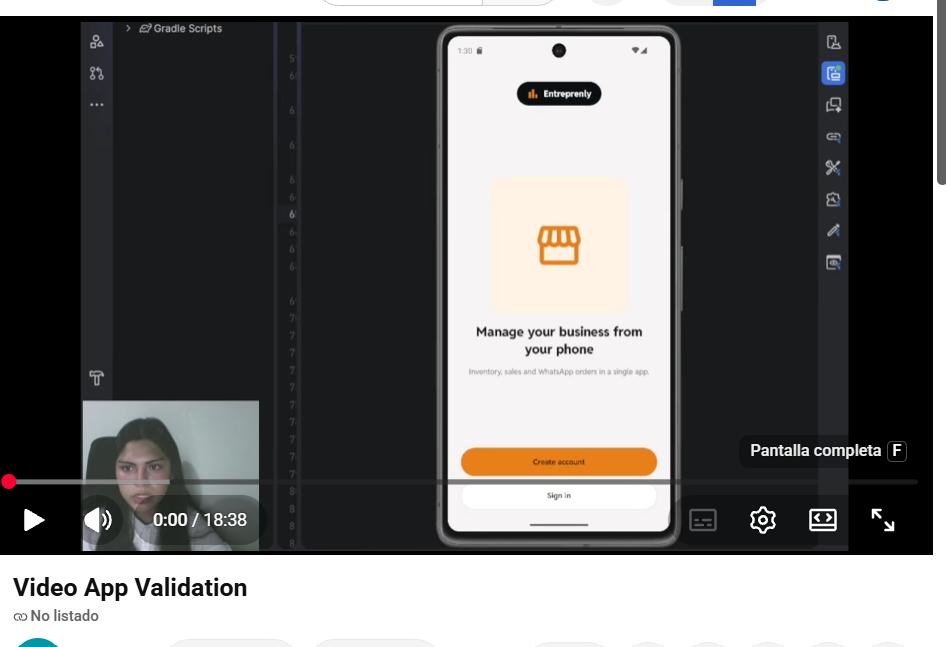

# Video App Validation

En esta sección se presenta el video de validación de la aplicación móvil **Entreprenly**, donde se realiza un recorrido completo por las funcionalidades implementadas y se verifica que cumplen con las historias de usuario planteadas en el alcance de esta entrega.

En el video se muestran los siguientes módulos (bounded contexts):

- **Profile & Auth:** registro, inicio de sesión, validación de credenciales y edición del perfil del negocio.
- **Inventory:** registro, edición y eliminación de productos, búsqueda y alertas de stock bajo.
- **Sales:** registro de ventas con cálculo automático del total, descuento del stock e historial de ventas.
- **Chatbot:** vinculación de WhatsApp, configuración de respuestas automáticas y atención de mensajes de clientes.
- **Subscription:** visualización de planes disponibles y cambio de plan.

**Enlace al video:** [Video App Validation – Entreprenly](https://youtu.be/WY-XirxHxoE?si=eWKP0wlKVMk9wBJ9)

**Duración:** [18:39] minutos

    

